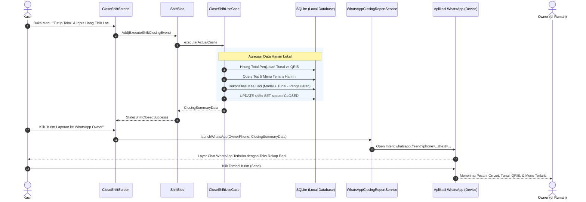

# Architecture Document — Flutter Clean Architecture & Local-First POS

Dokumen ini mendefinisikan arsitektur teknis, pola desain (*design patterns*), struktur modul, dan pedoman rekayasa perangkat lunak untuk sistem **PosUmkm (Local-First Offline POS)**.

---

## 1. Prinsip Utama Arsitektur (Guiding Principles)

1. **Local-First & Zero Network Blocker**: Semua alur kasir (tambah item, ubah varian, checkout tunai, verifikasi kamera QRIS, simpan transaksi, lihat riwayat, tutup shift) diproses secara instan di perangkat lokal tanpa bergantung pada koneksi internet.
2. **Clean Architecture (Feature-First)**: Pemisahan modular antara UI (*Presentation*), Aturan Bisnis (*Domain*), dan Akses Data (*Data*). Setiap fitur berdiri sebagai modul mandiri.
3. **State Management Standar**: Menggunakan **Flutter Bloc & Cubit** dengan *Unidirectional Data Flow* (Event -> BLoC -> State -> UI) untuk aliran data kasir yang terprediksi dan mudah diuji.
4. **On-Device OCR & Anti-Fraud Verification**: Menggunakan **Google ML Kit Text Recognition** lokal untuk memvalidasi bukti pembayaran QRIS secara instan tanpa internet, mencocokkan tanggal/jam transaksi secara ketat, dan menyimpan foto bukti bayar terkompresi (~50KB) ke penyimpanan lokal.
5. **Owner-Centric Reporting (Zero-Hassle WhatsApp & Excel)**:
   * **WhatsApp Closing Report**: Merangkai rekapitulasi harian terformat otomatis dan mengirimkannya langsung ke nomor WhatsApp Owner saat kasir tutup toko.
   * **Multi-Sheet Excel Engine**: Menghasilkan file spreadsheet `.xlsx` lokal dengan 3 sheet terstruktur (Ringkasan Harian, Log Transaksi Lengkap, dan Performa Menu).
6. **Idempotensi & Distributed Identity**: Semua entitas menggunakan **UUID v4** sebagai *primary key* unik global. Tidak menggunakan auto-increment integer lokal untuk menjamin keunikan saat mutasi diunggah ke Cloud Server.
7. **Integer Currency Representation**: Seluruh nilai mata uang disimpan dalam satuan Rupiah murni bertipe `int` (misal: `15000` untuk Rp 15.000) guna mencegah *floating-point rounding errors*.
8. **Adaptive UI Design**: Tampilan antarmuka otomatis menyesuaikan orientasi dan ukuran layar:
   * **Smartphone (Portrait)**: Panel katalog dengan *floating cart bar / bottom sheet* dan jendela kamera scan cepat.
   * **Tablet Kasir (Landscape)**: Tampilan dua kolom (*Master-Detail Split View*: Katalog 60% kiri, Keranjang & Checkout 40% kanan).

---

## 2. Lapisan Arsitektur (Layer Breakdown)

```
┌─────────────────────────────────────────────────────────────┐
│                    PRESENTATION LAYER                       │
│  Widgets, Screens, Dialogs, Adaptive Layouts, BLoC / Cubits │
└──────────────────────────────┬──────────────────────────────┘
                               │ Bergantung pada Domain (Inversi Dependensi)
┌──────────────────────────────▼──────────────────────────────┐
│                       DOMAIN LAYER                          │
│     Entities (Pure Dart), Value Objects, Use Cases,         │
│               Repository Interfaces (Contracts)             │
└──────────────────────────────▲──────────────────────────────┘
                               │ Diimplementasikan oleh Data Layer
┌──────────────────────────────┴──────────────────────────────┐
│                        DATA LAYER                           │
│  Repository Impl, SQLite DAOs, Local Data Sources, DTOs,    │
│  On-Device OCR Verifier, WhatsApp Reporter, Excel Generator │
└─────────────────────────────────────────────────────────────┘
```

### A. Presentation Layer
* **Tanggung Jawab**: Merender UI adaptif, menangani interaksi kamera kasir, dan memicu aksi kirim rekap WhatsApp.
* **Komponen**:
  * *Screens*: `PosAdaptiveScreen`, `CheckoutDialog`, `QrisScannerModal`, `CloseShiftScreen`, `HistoryScreen`, `ReportScreen`.
  * *BLoCs & Cubits*: `PosCatalogBloc`, `CartBloc`, `CheckoutBloc`, `QrisOcrCubit`, `ShiftBloc`, `ReportBloc`, `SyncStatusCubit`.
  * *Adaptive Builder*: Menggunakan `LayoutBuilder` untuk mendeteksi breakpoint layar (Smartphone Portrait vs Tablet Landscape).

### B. Domain Layer (Pure Dart — Bebas Dependensi UI Flutter)
* **Tanggung Jawab**: Logika bisnis inti dan aturan transaksi kasir.
* **Komponen**:
  * *Entities*: `Order`, `OrderItem`, `Product`, `Category`, `Shift`, `CashMovement`, `DailyClosingSummary`, `DigitalReceipt`.
  * *Use Cases*: `CreateOrderUseCase`, `CalculateChangeUseCase`, `VerifyQrisProofUseCase`, `CloseShiftUseCase`, `GenerateWhatsAppClosingTextUseCase`, `ExportSalesToExcelUseCase`.
  * *Repository Interfaces*: `OrderRepository`, `ProductRepository`, `ShiftRepository`, `ReportRepository`, `QrisVerifierRepository`.

### C. Data Layer
* **Tanggung Jawab**: Persistensi database lokal, pemrosesan citra kamera, pembentukan laporan WhatsApp, dan file Excel.
* **Komponen**:
  * *SQLite Database (via sqflite)*: Mode WAL (*Write-Ahead Logging*) untuk konkurensi tulis/baca tinggi.
  * *On-Device OCR Verifier (`QrisOcrService`)*: Memanfaatkan `google_mlkit_text_recognition` lokal untuk mengekstraksi kata kunci ("Berhasil"), tanggal transaksi, jam transaksi, nominal angka, dan nomor referensi RRN.
  * *WhatsApp Closing Report Service*: Membaca agregasi penjualan harian, memisahkan Tunai vs QRIS, menyusun pesan WhatsApp rapi, dan meluncurkan intent WhatsApp via `url_launcher`.
  * *Excel Generator Service*: Mengolah data riwayat transaksi menjadi file `.xlsx` dengan 3 sheet terpisah menggunakan package `excel`.

---

## 3. Struktur Direktori Proyek (`lib/`)

```text
lib/
├── core/
│   ├── camera/                     # Inisialisasi controller kamera lokal
│   │   └── camera_service.dart
│   ├── database/                   # SQLite database helper, schema, & migrations
│   │   ├── app_database.dart
│   │   ├── migrations/
│   │   └── tables/
│   ├── errors/                     # Failure & exception handling
│   │   ├── exceptions.dart
│   │   └── failures.dart
│   ├── sync/                       # CRDT & HLC timestamp utilities
│   │   ├── hlc_clock.dart          # Monotonic Hybrid Logical Clock
│   │   ├── crdt_mutation_tracker.dart
│   │   └── crdt_conflict_resolver.dart
│   ├── theme/                      # Styling, Colors, Typography (F&B Modern theme)
│   │   ├── app_colors.dart
│   │   └── app_theme.dart
│   └── utils/                      # Currency formatters, date utilities
│       ├── currency_formatter.dart # IDR 'Rp 15.000'
│       └── date_formatter.dart
│
├── features/
│   ├── pos/                        # Fitur Utama Katalog & Keranjang Kasir
│   │   ├── data/
│   │   │   ├── datasources/local/  # ProductDao, CategoryDao
│   │   │   ├── models/             # ProductModel, CategoryModel
│   │   │   └── repositories/       # ProductRepositoryImpl
│   │   ├── domain/
│   │   │   ├── entities/           # Product, Category, CartItem, ProductModifier
│   │   │   ├── repositories/       # ProductRepository
│   │   │   └── usecases/           # GetCatalogUseCase, SearchProductsUseCase
│   │   └── presentation/
│   │       ├── bloc/               # PosCatalogBloc, CartBloc
│   │       ├── screens/            # PosAdaptiveScreen (Smartphone vs Tablet)
│   │       └── widgets/            # ProductGridCard, CartSidePanel, MobileCartBottomSheet
│   │
│   ├── checkout/                   # Fitur Pembayaran, Verifikasi OCR QRIS, & Struk
│   │   ├── data/
│   │   │   ├── datasources/local/  # OrderDao, OrderItemDao
│   │   │   ├── datasources/ocr/    # QrisOcrService (ML Kit Text Recognition)
│   │   │   ├── models/             # OrderModel, QrisScanResultModel
│   │   │   └── repositories/       # OrderRepositoryImpl, QrisVerifierRepositoryImpl
│   │   ├── domain/
│   │   │   ├── entities/           # Order, PaymentDetails, QrisProofResult, DigitalReceipt
│   │   │   ├── repositories/       # OrderRepository, QrisVerifierRepository
│   │   │   └── usecases/           # ProcessCheckoutUseCase, VerifyQrisProofUseCase
│   │   └── presentation/
│   │       ├── bloc/               # CheckoutBloc, QrisOcrCubit
│   │       ├── screens/            # CheckoutDialog, QrisCameraScanModal, DigitalReceiptModal
│   │       └── widgets/            # CashDenominationButtons, QrisCameraOverlay, ProofThumbnailWidget
│   │
│   ├── shift/                      # Fitur Tutup Toko & Laporan WhatsApp ke Owner
│   │   ├── data/
│   │   │   ├── datasources/local/  # ShiftDao, CashLogDao
│   │   │   ├── services/           # WhatsAppClosingReportService
│   │   │   └── repositories/       # ShiftRepositoryImpl
│   │   ├── domain/
│   │   │   ├── entities/           # Shift, CashMovement, DailyClosingSummary
│   │   │   ├── repositories/       # ShiftRepository
│   │   │   └── usecases/           # CloseShiftUseCase, SendWhatsAppClosingReportUseCase
│   │   └── presentation/
│   │       ├── bloc/               # ShiftBloc
│   │       ├── screens/            # CloseShiftScreen, ShiftSummaryModal
│   │       └── widgets/            # CashReconciliationCard, SendWhatsAppReportButton
│   │
│   ├── history_and_reports/        # Riwayat Transaksi, Audit Bukti Bayar, & Ekspor Excel
│   │   ├── data/
│   │   │   ├── datasources/local/  # ReportDao
│   │   │   ├── services/           # ExcelExportService (Multi-Sheet Generator)
│   │   │   └── repositories/       # ReportRepositoryImpl
│   │   ├── domain/
│   │   │   ├── entities/           # DailySalesSummary, TopProductReport, ExcelExportResult
│   │   │   └── usecases/           # GetSalesHistoryUseCase, VoidOrderUseCase, ExportSalesToExcelUseCase
│   │   └── presentation/
│   │       ├── bloc/               # HistoryBloc, ReportBloc
│   │       ├── screens/            # HistoryScreen, ReportSummaryScreen, ProofImageDetailScreen
│   │       └── widgets/            # TransactionTile, ExcelExportCard, VoidAuthPinDialog
│   │
│   └── sync_cloud/                 # Sinkronisasi CRDT ke Cloud Server (Background)
│       ├── data/
│       │   ├── datasources/        # SyncQueueDao, CloudSyncApiClient
│       │   └── repositories/       # SyncRepositoryImpl
│       ├── domain/
│       │   ├── entities/           # SyncMutation, SyncStatus
│       │   └── usecases/           # TriggerCloudSyncUseCase
│       └── presentation/
│           ├── bloc/               # SyncStatusCubit
│           └── widgets/            # CloudSyncStatusBadge
│
├── app.dart                        # MaterialApp, MultiBlocProvider, Routes
└── main.dart                       # Entry point aplikasi (Inisialisasi SQLite & Kamera)
```

---

## 4. Alur Data & Sequence Diagram

### A. Alur Tutup Toko & Pengiriman Laporan WhatsApp ke Owner



---

## 5. Standar Teknologi & Rekomendasi Library (Tech Stack)

| Kebutuhan | Paket Rekomendasi | Peran & Justifikasi |
| :--- | :--- | :--- |
| **Language & SDK** | Dart 3.x / Flutter 3.x | Performa native, Ahead-Of-Time (AOT), fluid 60 FPS pada Android & iOS. |
| **State Management** | `flutter_bloc` & `equatable` | Standar industri POS, event-driven terprediksi, pemisahan state & UI yang rapi. |
| **On-Device OCR** | `google_mlkit_text_recognition` | Model OCR offline bawaan perangkat (tanpa internet & tanpa API call berbayar), latensi baca < 800ms. |
| **Akses Kamera** | `camera` | Menampilkan pratinjau live viewfinder cepat dengan tombol auto-capture. |
| **Integrasi WhatsApp** | `url_launcher` | Membuka aplikasi WhatsApp dengan nomor tujuan Owner dan pesan rekap tutup toko terformat otomatis. |
| **Ekspor Laporan** | `excel` | Menghasilkan file spreadsheet `.xlsx` murni secara lokal tanpa server (Multi-sheet: Ringkasan, Transaksi, Menu). |
| **File Sharing** | `share_plus` | Membagikan file Excel atau gambar struk langsung ke aplikasi lain (WhatsApp/Email/Drive). |
| **Database Lokal** | `sqflite` (dengan DAO) | SQLite native terpercaya, transaksi ACID, mode WAL, latensi < 1ms. |
| **Distributed IDs** | `uuid` (v4) | Mencegah konflik identitas data tanpa server. |
| **Format Mata Uang** | `intl` (`id_ID`) | Standardisasi pemisah ribuan mata uang Rupiah (`Rp 15.000`). |

---

## 6. Format Pesan WhatsApp & Struktur File Excel

### A. Template Pesan WhatsApp Tutup Toko
```text
📊 *LAPORAN TUTUP TOKO - {NAMA_TOKO}*
Tanggal : {HARI}, {TANGGAL}
Kasir   : {NAMA_KASIR}
========================================
💰 *RINGKASAN OMZET*
Total Transaksi : {TOTAL_TRX} Pesanan
Total Omzet     : Rp {TOTAL_OMZET}

💳 *RINCIAN PEMBAYARAN:*
- 💵 *Tunai (Cash)* : Rp {TOTAL_TUNAI} *(Wajib Setor Fisik)*
- 📱 *QRIS (Bank)*  : Rp {TOTAL_QRIS} *(Masuk Rekening)*

📦 *TOP 3 MENU TERLARIS:*
1. {MENU_1} : {QTY_1} Porsi
2. {MENU_2} : {QTY_2} Cup
3. {MENU_3} : {QTY_3} Porsi

💵 *REKAP KAS LACI KASIR:*
- Modal Awal Kasir : Rp {MODAL_AWAL}
- Kas Masuk Tunai  : Rp {TOTAL_TUNAI}
- Kas Keluar (Beban): -Rp {KAS_KELUAR}
- Uang Fisik Laci  : Rp {UANG_FISIK}
- Status Selisih   : *{STATUS_SELISIH}*
========================================
```

### B. Spesifikasi 3 Sheet Excel (.xlsx)
1. **Sheet 1 (Ringkasan Harian)**: Tabel penjualan harian (Tanggal, Jumlah Pesanan, Omzet Bersih, Porsi Tunai, Porsi QRIS).
2. **Sheet 2 (Log Transaksi Lengkap)**: Rincian baris per transaksi (Order ID, Jam, Kasir, Item Pesanan, Total, Metode Bayar, RRN QRIS).
3. **Sheet 3 (Laporan Produk & Kategori)**: Kuantitas terjual per produk beserta kontribusi nominal omzet.